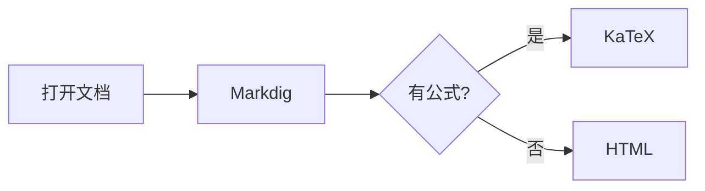

# 公式与图表

行内：$E = mc^2$ 和 $e^{i\pi}+1=0$。

$$
\int_{-\infty}^{\infty} e^{-x^2}\,dx = \sqrt{\pi}
$$

## 表格

| 批次 | 内容 | 状态 |
| --- | --- | --- |
| 一 | 主题 / 字体 / 灯箱 | 完成 |
| 二 | 公式 / 图表 / 长图 | 完成 |
| 三 | 标注 / 书签 / 朗读 | 完成 |

