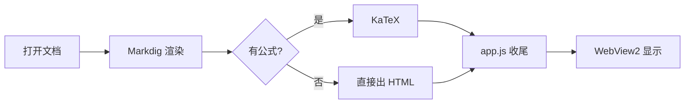
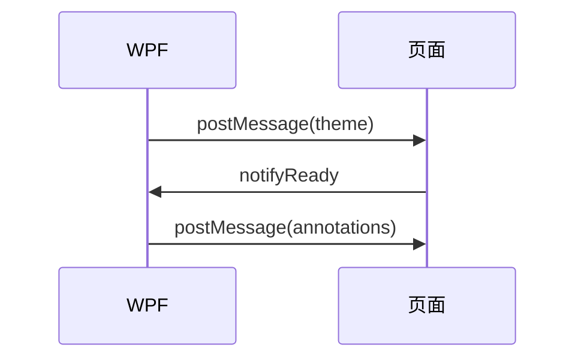

# 三批次功能验收

这一篇专门用来把 0.5.0 新加的东西一次性看全：主题、字体、公式、图表、代码高亮、表格排序、标注、书签、朗读、导出长图。

## 一、文本与排版

### 1.1 强调与删除线

普通段落里混着 **加粗**、*斜体*、~~删除线~~、==高亮标记==、`行内代码`，还有 H~2~O 这种下标和 x^2^ 这种上标。

> 引用块用来测左侧竖线和引用里的代码：
> ```csharp
> var theme = MarkdownThemes.Resolve("tokyo-night");
> ```

### 1.2 任务列表

- [x] 壳配色跟随主题
- [x] 补 10 套主题
- [x] 字体可选
- [ ] 导出长图（本页可以试）

### 1.3 脚注

这里挂一个脚注[^note]，看底下会不会自己长出来。

[^note]: 脚注正文。Markdig 的 UseFootnotes 会把它们收到底部。

## 二、数学公式

行内公式：质能方程 $E = mc^2$，欧拉恒等式 $e^{i\pi} + 1 = 0$。

块级公式：

$$
\int_{-\infty}^{\infty} e^{-x^2}\,dx = \sqrt{\pi}
$$

矩阵也来一个：

$$
\begin{pmatrix}
a & b \\
c & d
\end{pmatrix}
\begin{pmatrix}
x \\
y
\end{pmatrix}
=
\begin{pmatrix}
ax + by \\
cx + dy
\end{pmatrix}
$$

## 三、Mermaid 图表



时序图：



## 四、代码高亮

```javascript
const themes = ['one-light', 'tokyo-night', 'gruvbox-dark'];

function pick(list, isDark) {
  return list.filter((t) => t.isDark === isDark)
              .sort((a, b) => a.name.localeCompare(b.name));
}
```

```python
def trim(entries, limit=2000):
    """先砍老标注，再砍老书签。"""
    if len(entries) <= limit:
        return entries
    return sorted(entries, key=lambda e: e["created"])[-limit:]
```

```xml
<ComboBox x:Name="LightThemeBox"
          ItemTemplate="{StaticResource ThemeItemTemplate}"
          SelectionChanged="ThemeBox_Changed" />
```

```bash
dotnet build src/MdViewer/MdViewer.csproj -c Release
```

## 五、表格

行数不多的小表（不应出现内部滚动条）：

| 批次 | 内容 | 状态 |
| --- | --- | --- |
| 一 | 壳配色 / 8 套主题 / 字体 / 全屏 / 灯箱 | 完成 |
| 二 | KaTeX / Mermaid / hljs / front matter / 长图 | 完成 |
| 三 | 标注 / 书签 / 朗读 / 文件树 / 多标签 | 完成 |

点表头可以排序（三态：升序 → 降序 → 还原）。

## 六、图片灯箱

点下面这张图会开灯箱，滚轮缩放、拖动、双击还原、Esc 关闭。


## 七、脚注收尾

到这儿为止，标注、书签、朗读按钮都在工具栏上，右上角还能切无干扰。
